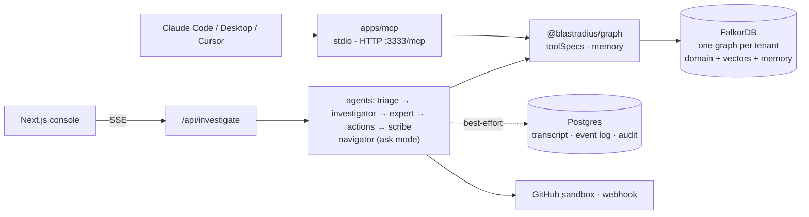
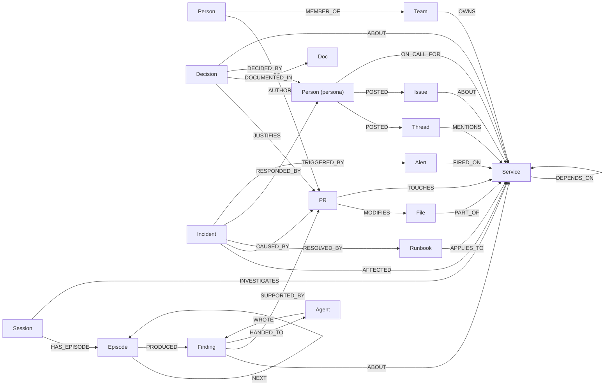

# Blastradius

**When an alert fires, a team of AI agents works over one FalkorDB graph of your services, code, PRs, people, incidents, decisions and chat to tell you what else breaks, what probably caused it, who can fix it, and what worked last time. Every claim comes with a Why? chip showing the exact Cypher and the graph path behind it, and the agents act: they open an issue, ping the team and draft a rollback PR.**


<!-- TODO(team): record docs/media/demo.gif (and link the demo video) -->

Submission to **Graph Hacks: Context for AI Agents** (FalkorDB × WeMakeDevs, Oct 2026).

## The four questions

| # | Question | How the graph answers it |
|---|---|---|
| 1 | **What else breaks?** | Multi-hop `DEPENDS_ON` walk, ranked by betweenness centrality (`blast_radius`) |
| 2 | **What probably caused it?** | Recent PRs that `TOUCHES` the service or its dependencies (`suspect_changes`), plus similar past incidents via the FalkorDB vector index (`similar_incidents`) |
| 3 | **Who can fix it?** | PageRank over `Person-AUTHORED->PR-TOUCHES->Service`, filtered by team and on-call (`who_knows`, `on_call`) |
| 4 | **What worked last time?** | Incidents and runbooks recalled from earlier sessions (`recall_memory`, `past_incidents`) |

## Tracks entered: all three

| Track | Criterion | Feature | Where to see it |
|---|---|---|---|
| **01 Agents That Act on Connected Data** | Multi-hop reasoning | `blast_radius` (variable-length `DEPENDS_ON*1..N`), `suspect_changes` (`TOUCHES` + `DEPENDS_ON*0..N`), `decision_trace` | `packages/graph/src/tools/`, console tool timeline |
| | Graph algorithms as agent tools | PageRank (`who_knows`), betweenness (`blast_radius`, `critical_services`), shortest path (`explain_path`), CDLP/WCC (`failure_communities`) | [`docs/CYPHER.md`](docs/CYPHER.md) |
| | Same tools over MCP | `apps/mcp`: every tool in `toolSpecs`, over stdio and Streamable HTTP | [MCP section](#use-the-tools-from-claude-code-claude-desktop-or-cursor), `pnpm mcp` |
| | Real actions | GitHub issue, Slack/Discord webhook, rollback PR in a sandbox repo (dry run when unconfigured) | **Actions** in the run timeline; `packages/agents/src/actions.ts` |
| | Why? on every claim | Each finding stores the exact Cypher string that ran plus its evidence path | Why? chip → drawer in the console |
| **02 Agent Memory and Coordination** | Episodic memory | `Session-[:HAS_EPISODE]->Episode-[:NEXT]->Episode` | `/memory` (Memory inspector) |
| | Semantic memory | Domain graph + `Finding` nodes (`ABOUT`, `SUPPORTED_BY`) | Memory inspector subgraph |
| | Procedural memory | `Incident` + `Runbook` written by the Scribe on **Close incident** | Close incident button → `/memory` procedural panel |
| | Handoffs only through graph state | `Finding-[:HANDED_TO]->Agent`, read with `read_handoffs` | Handoff events in the timeline; [`docs/ARCHITECTURE.md`](docs/ARCHITECTURE.md#2-one-investigation-end-to-end) |
| | Recall across sessions | `recall_memory` excludes the current session and returns earlier findings and incidents with the connecting path | **Recalled memory** card at the start of a run |
| | One graph per tenant | `blastradius_acme`, `blastradius_globex` | Tenant selector in the top bar; `redis-cli -p 6380 GRAPH.LIST` |
| | Concurrency | 10 concurrent investigations (two sharing a session); checks episode chains, tenant isolation, event order | `pnpm concurrency` |
| **03 Company Brain** | Tickets, threads, ADRs, docs with the code | `Issue`, `Thread`, `Decision`, `Doc` nodes linked to `Service`, `PR`, `Person` | Graph view; [data model](#graph-data-model) |
| | Who owns or knows X | `who_knows` (real authors only, topic or service), `service_context`; `/people` page with each persona's and author's live activity (TODO: page not built yet) | Ask mode; `/people` |
| | Decision tracing | `Doc <-DOCUMENTED_IN- Decision -JUSTIFIES-> PR <-CAUSED_BY- Incident` (`decision_trace`) | Ask mode, Why? drawer |
| | Ask the company with sources | `ask_company`: vector search across text labels, then expansion to owners, PRs, decisions | Ask mode in the console |
| | Incremental re-ingest | `ingestDelta` MERGEs real PRs merged after the snapshot (`data/deltas/`), with no reload; TOUCHES are derived for them | `pnpm --filter @blastradius/ingest add-prs --tenant acme` (the acme cart suspect changes from PR #3988 to #4087) |

## The five graph jobs

FalkorDB isn't a side store here. It does five separate jobs, and the product needs all of them:

1. **Multi-hop impact.** Variable-length traversals over `DEPENDS_ON`, `TOUCHES` and `AUTHORED` answer "what else breaks" and "what changed nearby" in one query each.
2. **Algorithms.** `algo.betweenness`, `algo.pageRank`, `algo.labelPropagation` / `algo.WCC` and `shortestPath` run inside FalkorDB and come back as tool results.
3. **Vector-in-graph recall.** Embeddings (384-dim MiniLM) are stored on `Incident`, `Decision`, `Doc`, `Issue`, `Thread` and `Finding` nodes as `vecf32` with a FalkorDB vector index. `db.idx.vector.queryNodes` and the graph expansion from each hit run **in the same Cypher query**.
4. **Memory.** Sessions, episodes, findings and handoffs are nodes and edges in the tenant graph, linked to the domain nodes they're about.
5. **Company brain.** Tickets, chat threads, ADRs and docs sit in the same graph as the code and the people, so "why did we…" is a path query.

## Architecture



The details, including a sequence diagram of one investigation, the memory model, failure modes and key decisions, are in [`docs/ARCHITECTURE.md`](docs/ARCHITECTURE.md).

## Graph data model

One FalkorDB graph per tenant. Every node has a `uid` (`Label:key`, e.g. `Service:checkout`, `PR:4087`). **R** = real public git history, **S** = synthetic (seeded, `synthetic: true`), **M** = memory written at runtime.

| Label | Src | Key properties |
|---|---|---|
| `Service` | R (curated) | `name`, `language`, `kind`, `tier`, `repoPath` |
| `File` | R | `path`, `service` |
| `PR` | R | `number`, `title`, `mergedAt`, `additions`, `deletions`, `isBot`, `url` |
| `Person` (real) | R | `name`, `isBot`, `prCount`, `persona: false`; keyed by slugified name, no emails. Carries **only real facts**: the PRs they authored. |
| `Person` (persona) | S | `name` (clearly fictional), `role` (SRE, Engineering manager…), `persona: true`; uid `Person:persona-<slug>`. Carries everything fictional involving a person: chat, tickets, ADR sign-off, on-call, incident response. |
| `Team` | S | `name`, `slack` |
| `Issue` | S | `key`, `title`, `status`, `priority`, `embedding` |
| `Thread` | S | `channel`, `title`, `text`, `embedding` |
| `Decision` | S | `key` (ADR-…), `title`, `status`, `context`, `decision`, `embedding` |
| `Doc` | S | `title`, `kind`, `text`, `embedding` |
| `Incident` | S / M | `key`, `title`, `summary`, `rootCause`, `severity`, `startedAt`, `embedding` |
| `Runbook` | S / M | `title`, `steps[]` |
| `Alert` | S / M | `title`, `metric`, `value`, `firedAt` |
| `Session` | M | `sessionId`, `mode`, `question`, `status` |
| `Episode` | M | `seq`, `agent`, `kind`, `summary` |
| `Finding` | M | `claim`, `confidence`, `about[]`, `evidence[]`, `cypher[]`, `embedding` |
| `Agent` | M | `name` |



The full list of relationship types and their directions is `REL_TYPES` in [`packages/shared/src/index.ts`](packages/shared/src/index.ts). `TOUCHES` is derived at load time from `PR-MODIFIES->File-PART_OF->Service`. Indexes: range indexes on `uid` for every label (plus a few lookup keys), full-text indexes on names and titles, and vector indexes (384-dim, cosine) on the six embedded labels.

## What breaks without FalkorDB

Stop the container (`docker compose stop falkordb`) and:

- **Every tool fails.** All 16 tools are Cypher queries against the tenant graph. The investigation emits a fatal `falkordb` error, and the console shows a red health banner.
- **Memory is gone.** Sessions, episodes, findings and handoffs are graph nodes, so agents can't hand off work, and cross-session recall returns nothing because it can't run.
- **Vectors are gone.** Similar-incident search and Ask the company use FalkorDB's vector index. There's no other vector store.
- **MCP returns errors.** MCP tools come back with `isError: true`, and `GET /health` returns 503.

Postgres only holds the chat transcript, the event log used to replay a session, the action audit log and ingest job records. No agent reads from it. If Postgres is down, investigations still run.

## Cypher and algorithms

| Tool | FalkorDB feature |
|---|---|
| `blast_radius` | `DEPENDS_ON*1..maxHops` + `algo.betweenness` |
| `critical_services` | `algo.betweenness` |
| `who_knows` | `algo.pageRank` over authorship |
| `explain_path` | `shortestPath` (in `WITH`) |
| `failure_communities` | `algo.labelPropagation` (CDLP) / `algo.WCC` |
| `similar_incidents`, `ask_company`, `recall_memory` | `db.idx.vector.queryNodes` + graph expansion in the same query |
| `search_nodes` | `db.idx.fulltext.queryNodes` |
| `suspect_changes`, `past_incidents`, `decision_trace`, `service_context`, `on_call` | Pattern matching over `TOUCHES`, `CAUSED_BY`, `JUSTIFIES`, `ON_CALL_FOR`… |
| `record_finding`, `read_handoffs` | Memory writes and reads (`HANDED_TO`) |

Every query, with comments, is in **[`docs/CYPHER.md`](docs/CYPHER.md)**.

## Quick start (no API key needed)

Requirements: Docker, Node 22, pnpm 10 (`corepack enable`).

```bash
cp .env.example .env              # defaults work as-is
docker compose up -d              # FalkorDB on :6380, Postgres on :5434
export ONNXRUNTIME_NODE_INSTALL_CUDA=skip   # optional: skips a large CUDA download on linux/x64
pnpm install
pnpm --filter @blastradius/mcp fetch-model   # MiniLM embedding model (~90 MB) into .cache/hf (skip if EMBEDDINGS=hash)
pnpm db:migrate                   # Postgres tables
pnpm graph:load                   # load data/*.json into FalkorDB (one graph per tenant)
pnpm dev                          # http://localhost:3000
```

With no API key, `AGENT_MODE=auto` runs **scripted mode**: the same tools in a fixed order, with claims templated from the rows. It's deterministic, and the UI shows a badge.

**Embeddings.** `fetch-model` uses curl (with retries) to download `Xenova/all-MiniLM-L6-v2` into the transformers.js cache, because the library's own download is unreliable on slow links. The equivalent one-liner for the large file is `curl -fL --retry 5 -o .cache/hf/Xenova/all-MiniLM-L6-v2/onnx/model.onnx https://huggingface.co/Xenova/all-MiniLM-L6-v2/resolve/main/onnx/model.onnx`. If the model can't load, the graph package falls back to hashed embeddings and prints a warning. `EMBEDDINGS=hash` forces the fallback with no download at all. **Never mix the two backends in one graph:** their vectors live in different spaces, so similarity search returns nonsense. If you switch `EMBEDDINGS`, reload with `pnpm graph:load` (it resets the graphs), and serve with the same value you seeded with.

**LLM mode:** set `ANTHROPIC_API_KEY` (or `LLM_PROVIDER=openai` + `OPENAI_API_KEY`) in `.env`. `AGENT_MODE=auto` then picks `llm`. Force either mode with `AGENT_MODE=llm|scripted`.

**Real actions:** set `GITHUB_TOKEN` + `GITHUB_SANDBOX_REPO=owner/repo` (issues and rollback PRs) and `WEBHOOK_URL` (Slack or Discord). Unset, they run as dry runs and show the payload.

**Everything in Docker:** `docker compose --profile app up --build` (seed → mcp on :3333 → web on :3000).

## Use the tools from Claude Code, Claude Desktop or Cursor

The MCP server exposes the same tool registry the agents use (15 read tools by default; all 16 with `MCP_ALLOW_WRITES=true`), plus two resources (`blastradius://tenants`, `blastradius://schema`). Every tool takes `tenant` (`acme` or `globex`). `record_finding` (a graph write) only appears when `MCP_ALLOW_WRITES=true`.

**Claude Code over HTTP.** Start the server, then add it:

```bash
pnpm mcp                          # Streamable HTTP on http://localhost:3333/mcp
claude mcp add --transport http blastradius http://localhost:3333/mcp
```

**Claude Code over stdio** (no separate server process):

```bash
claude mcp add --transport stdio blastradius -- pnpm --dir /absolute/path/to/blastradius --filter @blastradius/mcp stdio
```

**Claude Desktop** (`claude_desktop_config.json`):

```json
{
  "mcpServers": {
    "blastradius": {
      "command": "pnpm",
      "args": ["--dir", "/absolute/path/to/blastradius", "--filter", "@blastradius/mcp", "stdio"]
    }
  }
}
```

If Claude Desktop can't find `pnpm` on its PATH, use the absolute path from `which pnpm`. Alternatively, run tsx directly: `"command": "/absolute/path/to/blastradius/apps/mcp/node_modules/.bin/tsx", "args": ["/absolute/path/to/blastradius/apps/mcp/src/main.ts", "--stdio"]`.

**Cursor** (`.cursor/mcp.json` in your project, or `~/.cursor/mcp.json`):

```json
{
  "mcpServers": {
    "blastradius": { "url": "http://localhost:3333/mcp" }
  }
}
```

The server reads the repo-root `.env` (`FALKORDB_URL` etc.) in every mode. In stdio mode it logs only to stderr.

Try asking: *"Using blastradius on tenant acme, what breaks if checkout fails, and who should I page?"*

## Data provenance

| Tenant | Source | License | Real | Synthetic |
|---|---|---|---|---|
| `acme` | [open-telemetry/opentelemetry-demo](https://github.com/open-telemetry/opentelemetry-demo) | Apache-2.0 | services, files, PRs, PR authors and what they changed (from public git history) | personas, teams, on-call, incidents, runbooks, tickets, threads, ADR text, docs |
| `globex` | [GoogleCloudPlatform/microservices-demo](https://github.com/GoogleCloudPlatform/microservices-demo) | Apache-2.0 | same | same |

People are keyed by slugified name only, and the dataset contains no email addresses. Synthetic nodes carry `synthetic: true`. How the snapshots are built and validated is in [`data/README.md`](data/README.md).

### Ethics: real people vs personas

The real git contributors in the graph are real people, so we only state real, public facts about them: which PRs they authored and which files those PRs changed (and, derived from that, which services they know). `who_knows` ranks only these real authors, by their real authorship.

Everything fictional that involves a person belongs to **personas**: clearly fictional people (`Person {persona: true, role}`) who post the chat threads and file the tickets (`POSTED`), sign off ADRs (`DECIDED_BY`), carry the on-call rotation (`ON_CALL_FOR`) and respond to incidents (`RESPONDED_BY`). Synthetic text never quotes a real contributor or attributes statements to one. It may cite real PRs by number and title.

> TODO(platform): the persona policy is in the contract and the spec (SPEC §1) but not yet in the data. The current `data/*.json` still attach synthetic chat and on-call to real contributors (0 persona nodes as of this writing). Remove this note once the data workstream regenerates the snapshots.

## Deployment

FalkorDB Cloud + Neon/Render Postgres + Render (web and MCP from one Dockerfile via [`render.yaml`](render.yaml)). Step by step: **[`docs/DEPLOY.md`](docs/DEPLOY.md)**.

> TODO(team): live URL once deployed.

## Repo structure

```
apps/
  web/        Next.js 15 console: incident + ask modes, graph view, Why? drawer, /memory inspector, /people (TODO)
  mcp/        MCP server (stdio + Streamable HTTP) over the same tool registry
packages/
  shared/     The contract: labels, relationship types, tool schemas, events (zod)
  graph/      The only FalkorDB code: connection, schema, tools, memory, loaders, embeddings
  agents/     investigate() pipeline, scripted + LLM modes, actions
  db/         Drizzle schema + best-effort Postgres helpers
  ingest/     Public git history + synthetic org data → data/<tenant>.json
data/         Snapshots, scenarios, deltas for incremental re-ingest
docs/         SPEC, ARCHITECTURE, CYPHER, DEMO, DEPLOY, LEARN
```

## Scripts

| Command | What it does |
|---|---|
| `pnpm dev` | Next.js console on :3000 |
| `pnpm db:migrate` | Apply Postgres migrations |
| `pnpm data:build` | Rebuild `data/*.json` from the public repos |
| `pnpm graph:load` | Load the snapshots into FalkorDB (one graph per tenant) |
| `pnpm seed` | `db:migrate` + `graph:load` |
| `pnpm smoke` | Scripted incident + close + recall + ask runs on both tenants, with checks (own graph namespace) |
| `pnpm concurrency` | 10 concurrent investigations; checks memory integrity and tenant isolation |
| `pnpm --filter @blastradius/ingest add-prs --tenant acme` | Incremental re-ingest of PRs merged after the snapshot |
| `pnpm --filter @blastradius/agents scenarios` | Check every scenario in `data/scenarios.json` against the SPEC quality bar |
| `pnpm --filter @blastradius/mcp fetch-model` | Download the embedding model into `.cache/hf` |
| `pnpm mcp` | MCP server over Streamable HTTP on :3333 |
| `pnpm --filter @blastradius/mcp stdio` | MCP server over stdio |
| `pnpm typecheck` / `pnpm test` | Typecheck all packages / unit tests (no DB) |

CI (`.github/workflows/ci.yml`) runs typecheck and unit tests, then an integration job against real FalkorDB and Postgres service containers: migrate → load → smoke → graph integration tests → MCP health and `tools/list`.

## How we used AI

We used **Claude Code (Claude Opus)** as a coding assistant to scaffold and implement much of the code, under the team's direction. An orchestrator agent coordinated sub-agents, one per workstream (graph, data, agents, web, platform), each limited to its own files and working from a shared written contract (`packages/shared`) and spec (`docs/SPEC.md`).

The humans chose the idea, the architecture and the graph data model, wrote and reviewed the spec, reviewed and verified the output, and are responsible for every line. Every teammate must be able to explain the graph model, the queries, the architecture and the decisions. [`docs/LEARN.md`](docs/LEARN.md) is the study guide we use for that (TODO(lead): not written yet).

Each teammate's contribution, in their own words:

- TODO(teammate 1): what you did
- TODO(teammate 2): what you did
- TODO(teammate 3): what you did

## Team

- TODO(team): names and links

## License

[MIT](LICENSE). The source repositories the real data comes from are Apache-2.0 (see [Data provenance](#data-provenance)).
