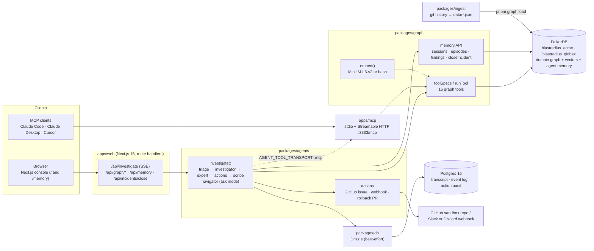
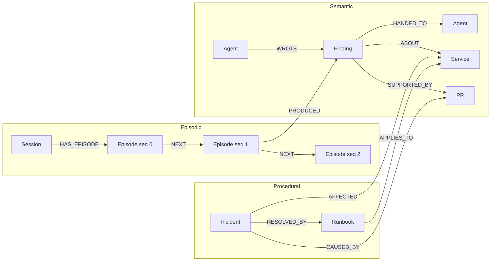

# Architecture

This document explains how Blastradius is put together and why. The vocabulary (labels, relationship types, tools, events) is defined in code in [`packages/shared/src/index.ts`](../packages/shared/src/index.ts); the full spec is [`docs/SPEC.md`](SPEC.md); every Cypher query and graph algorithm we depend on is in [`docs/CYPHER.md`](CYPHER.md).

## 1. Components and boundaries



| Component | Package | Owns | Talks to |
|---|---|---|---|
| Console | `apps/web` | Pages (`/` console, `/memory` inspector, `/people` TODO), SSE stream, graph view, Why? drawer | `@blastradius/agents`, `@blastradius/graph` (read models) |
| Agent pipeline | `packages/agents` | `investigate()`, scripted/LLM modes, actions | graph (tools + memory), db |
| Graph layer | `packages/graph` | The only code that talks to FalkorDB: connection, schema, tools, memory, loaders, embeddings | FalkorDB |
| MCP server | `apps/mcp` | Exposes `toolSpecs` over MCP | graph |
| Bookkeeping | `packages/db` | Drizzle schema + best-effort helpers | Postgres |
| Ingest | `packages/ingest` | Clones the public repos, builds `data/<tenant>.json`, loads them | graph (`loadSnapshot`, `ingestDelta`) |
| Contract | `packages/shared` | Types, whitelists, zod tool schemas | (nothing) |

The boundary that matters: **only `packages/graph` imports the `falkordb` client**, and it converts every FalkorDB value into plain JSON keyed by `uid` (`Service:checkout`, `PR:4087`) before anything leaves it. FalkorDB internal ids never reach the UI, the agents or MCP clients.

## 2. One investigation, end to end

```mermaid
sequenceDiagram
  autonumber
  actor U as User
  participant UI as Console (browser)
  participant RT as POST /api/investigate
  participant AG as investigate()
  participant G as packages/graph
  participant FK as FalkorDB (blastradius_acme)
  participant PG as Postgres

  U->>UI: "checkout 5xx at 12%"
  UI->>RT: InvestigateRequest {tenant, mode:'incident', alert}
  RT->>AG: investigate(req)
  AG->>PG: save user message (best-effort)
  AG-->>UI: run_started (SSE)
  AG->>G: startSession()
  G->>FK: MERGE (:Session {sessionId})-[:INVESTIGATES]->(:Service)
  AG->>G: runTool('recall_memory')
  G->>FK: findings + resolved incidents from OTHER sessions
  AG-->>UI: memory_recalled
  loop each agent: triage → investigator → expert → scribe
    AG->>G: recordEpisode(agent)
    G->>FK: CREATE (:Episode) + HAS_EPISODE / NEXT
    AG->>G: runTool('read_handoffs')  (not for triage)
    G->>FK: (f:Finding {sessionId})-[:HANDED_TO]->(:Agent {name})
    AG->>G: runTool(blast_radius | suspect_changes | who_knows | …)
    G->>FK: GRAPH.RO_QUERY (Cypher + algo.* / vector index)
    FK-->>G: rows + paths
    G-->>AG: GraphToolResult {cypher, params, rows, paths}
    AG-->>UI: tool_call / tool_result
    AG->>G: recordFinding({claim, evidence, cypher, handTo})
    G->>FK: CREATE (:Finding) + WROTE / ABOUT / SUPPORTED_BY / HANDED_TO / PRODUCED
    AG-->>UI: finding, handoff
  end
  AG->>AG: actions (GitHub issue, webhook, rollback PR; dry_run if unconfigured)
  AG-->>UI: action, agent_message {claims → findingIds}
  AG-->>UI: run_finished
  Note over AG,PG: every event is also appended to agent_events (best-effort) for replay
```

Things to notice:

- **Handoffs are graph writes.** Agent N records a `Finding` with `handTo`; agent N+1 starts by calling `read_handoffs`, which reads `(:Finding {sessionId})-[:HANDED_TO]->(:Agent {name})`. Agent N's text is never pasted into agent N+1's prompt.
- **The Why? chip is exact.** A finding stores `cypher[]`, which is copied verbatim from the `GraphToolResult.cypher` that produced its evidence. The drawer shows that string, its params and the returned paths.
- **Postgres only sees the transcript.** The event log lets the UI replay a session; nothing in it is read back by an agent.

## 3. Memory model

All memory lives in the tenant's FalkorDB graph, next to the domain data it refers to. That is what makes recall a graph query instead of a lookup in a separate store.



| Kind | What it is | Written by | Read by |
|---|---|---|---|
| **Episodic** | What happened in a session, in order: `Session-[:HAS_EPISODE]->Episode-[:NEXT]->Episode` | `startSession`, `recordEpisode` (each agent start, recall, action, close) | Memory inspector |
| **Semantic** | The domain graph itself, plus `Finding` nodes: claims linked to the nodes they are about and the evidence behind them | `recordFinding` (the `record_finding` tool) | `read_handoffs`, `recall_memory`, Why? drawer |
| **Procedural** | `Incident` + `Runbook` nodes: what broke, what caused it, what fixed it | Seed data (synthetic) and the Scribe on **Close incident** (`closeIncident`) | `past_incidents`, `similar_incidents`, `recall_memory` |

The real queries, copied from `packages/graph` (all of them, with live outputs, are in [`docs/CYPHER.md`](CYPHER.md#memory-track-02)):

```cypher
// Append an Episode to the session's chain. seq is computed INSIDE the write
// query (FalkorDB serialises writes per graph), so concurrent appends are safe.
MATCH (s:Session {sessionId: $sessionId})
OPTIONAL MATCH (s)-[:HAS_EPISODE]->(prev:Episode)
WITH s, prev ORDER BY prev.seq DESC LIMIT 1
WITH s, prev, CASE WHEN prev IS NULL THEN 0 ELSE prev.seq + 1 END AS seq
CREATE (ep:Episode {uid: 'Episode:' + $sessionId + ':' + toString(seq), sessionId: $sessionId, seq: seq,
                    agent: $agent, kind: $kind, summary: $summary, at: $now})
CREATE (s)-[:HAS_EPISODE]->(ep)
FOREACH (_ IN CASE WHEN prev IS NULL THEN [] ELSE [1] END | CREATE (prev)-[:NEXT]->(ep))
RETURN ep.uid AS uid, seq
```

```cypher
// Findings in THIS session handed to the calling agent (graph-only handoff)
MATCH p = (from:Agent)-[:WROTE]->(f:Finding {sessionId: $sessionId})-[:HANDED_TO]->(:Agent {name: $agent})
RETURN f.id AS finding, f.uid AS uid, from.name AS from, f.kind AS kind, f.claim AS claim,
       f.confidence AS confidence, f.about AS about, f.evidence AS evidence, f.cypher AS cypher,
       f.createdAt AS createdAt, p AS path
ORDER BY createdAt ASC
```

`recall_memory` is a single `CALL { … UNION ALL … }` query with four branches, and every branch excludes the current session: findings `ABOUT` the service, resolved incidents on the service with their `RESOLVED_BY` runbook, and vector-index matches on `Finding` and on `Incident` for the question text. Each row carries the path that connects it to the service.

**Concurrency.** Episode `seq` numbers are computed inside the write query. FalkorDB runs writes to one graph one at a time, and each query is atomic, so parallel agents appending to the same session get distinct, gap-free sequence numbers. `pnpm concurrency` exercises this. It starts 10 scripted investigations at once across both tenants (two of them share one session, which is the real race), then reads the stores back and checks three things: every session's Episode chain is intact (seq 0..n-1, one `NEXT` per step, no forks or duplicates); no finding references a node or session from the other tenant; and there are no event-seq gaps in Postgres. By default it runs in its own graph namespace (`concurrency_…`), so the demo graphs stay clean.

**Cross-session recall** is the payoff: close an incident in session A (the Scribe writes `Incident` + `Runbook` linked to the service and the cause PR), start session B on the same service, and `recall_memory` returns A's incident and runbook with the graph path that connects them.

## 4. Multi-tenancy

One FalkorDB graph per tenant: `graphName('acme') = 'blastradius_acme'`, `blastradius_globex`. Every tool call carries `tenant`, injected by code (the agents never choose it; MCP clients must pass it). Tenants share no nodes, so isolation is structural: a query on one graph cannot reach another tenant's data. Postgres rows carry a `tenant` column for listing sessions.

## 5. Tool transports: direct vs MCP

The same registry, `toolSpecs` from `@blastradius/graph`, is served three ways:

| Consumer | How it calls tools | Context injection |
|---|---|---|
| Agents, `AGENT_TOOL_TRANSPORT=direct` (default) | In-process `runTool(name, ctx, input)` | `tenant`, `sessionId`, `agent` from code |
| Agents, `AGENT_TOOL_TRANSPORT=mcp` | MCP `Client` + `StreamableHTTPClientTransport` to `MCP_URL`, parses `structuredContent` back to `GraphToolResult` | same, sent as tool arguments |
| External MCP clients | stdio or Streamable HTTP (`apps/mcp`) | the client passes `tenant` (and `sessionId`/`agent` for memory tools) |

The MCP server (`apps/mcp/src/server.ts`) registers each tool with `inputSchema = { tenant: z.enum(TENANTS), ...ToolInputSchemas[name].shape }`. Memory tools (`recall_memory`, `read_handoffs`, `record_finding`) also get optional `sessionId` and `agent`; `read_handoffs` and `record_finding` return a tool error if either is missing. The write tool `record_finding` is registered only when `MCP_ALLOW_WRITES=true`. Results come back as `content: [{type:'text', text: JSON}]` plus `structuredContent`. Resources: `blastradius://tenants` (tenants + live counts) and `blastradius://schema` (labels, relationship directions, documented and live indexes, exposed tools).

The HTTP transport is stateful: an `initialize` POST creates a session (the SDK returns `mcp-session-id`), and later POST/GET/DELETE requests on `/mcp` are routed by that header. `GET /health` returns `{ ok, falkordb }` (HTTP 503 when FalkorDB is unreachable).

## 6. Failure modes

| Failure | What the user sees | Why |
|---|---|---|
| **FalkorDB down** | Investigation fails visibly: `error {where:'falkordb', fatal:true}` then `run_finished {status:'error'}`; `/api/health` reports `falkordb.ok=false` and the UI shows a red banner; MCP tools return `isError: true`; MCP `/health` returns 503 | Every tool result, every memory read and write, and every vector search is a FalkorDB query. There is no cache or fallback copy of the graph, by design (hackathon rule: remove FalkorDB and the product stops). |
| **Postgres down** | Investigations still run and stream. Session replay and the action audit log are missing for that run. | All `packages/db` helpers are best-effort: they catch, log and return null/empty. |
| No LLM API key | Scripted mode (badge in the UI): same tools, fixed order, claims templated from rows | `AGENT_MODE=auto` falls back to `scripted` |
| No GitHub token / webhook | Actions return `status:'dry_run'` with the payload that would have been sent | Demo and CI never need secrets |
| Embedding model can't download | Set `EMBEDDINGS=hash` (deterministic hashed bag-of-words, 384 dims). Seed and serve with the same backend. | Vectors from different backends aren't comparable |

## 7. Key decisions

| Decision | Why |
|---|---|
| **Vectors in FalkorDB** (vector index + `vecf32`), not a separate vector store | Similarity search and graph expansion happen **in one Cypher query**: `CALL db.idx.vector.queryNodes(...) YIELD node` then `MATCH (node)-[:CAUSED_BY]->(pr)`. A separate store would need a second round-trip and an id join, and the result would not be a graph path the Why? drawer can show. |
| **Postgres only for bookkeeping** | Keeps the line clear for judges and for us: anything an agent reasons over is in FalkorDB. Postgres holds what a normal web app needs (transcript, event log for replay, action audit, ingest jobs). |
| **Agent memory in the same graph as domain data** | A `Finding` is `ABOUT` a `Service` and `SUPPORTED_BY` a `PR`, so "what did we learn about checkout last time?" is a one-hop query, and the memory inspector can draw memory and domain nodes together. |
| **Handoffs only through graph state** | Coordination is inspectable and replayable (it's in the graph), and the concurrency script can show agents in different sessions not stepping on each other. |
| **Scripted mode** | The product, CI and the demo work with no API key, deterministically. The LLM mode uses the same tools with the same Why? evidence. |
| **`uid` ids everywhere** (`Label:key`) | Stable across reloads (FalkorDB internal ids are not), readable in Cypher and in the UI, and they keep internal ids out of every API. |
| **"Recent" measured from the newest PR in the graph** | The snapshot is a fixed point in time; measuring from today would make every PR "old" after a week and break the demo. |
| **Whitelisted labels and relationship types** | Cypher cannot parameterise labels, so the only interpolated parts of a query are checked against `NODE_LABELS` / `REL_TYPES` first. All values are parameters. |
| **Real people carry only real facts; personas carry the fiction** | Real contributors appear only through public git facts (`AUTHORED` PRs, and what those PRs touched), and `who_knows` ranks only them. Synthetic chat, tickets, ADR sign-off, on-call and incident response belong to fictional personas (`Person {persona: true, role}`, `POSTED`). We never attribute invented statements or duties to real people. The planned `/people` page reads each person's activity live from the graph (`listPeople` / `personActivity`, SPEC §3), including findings from agent sessions that name them. TODO(platform): in the contract and spec, not yet in data/graph/web at the time of writing. |
| **TS source packages, no build step** | Fewer moving parts in a 4-day hackathon: `tsx` for scripts and the MCP server, `transpilePackages` for Next.js. |
